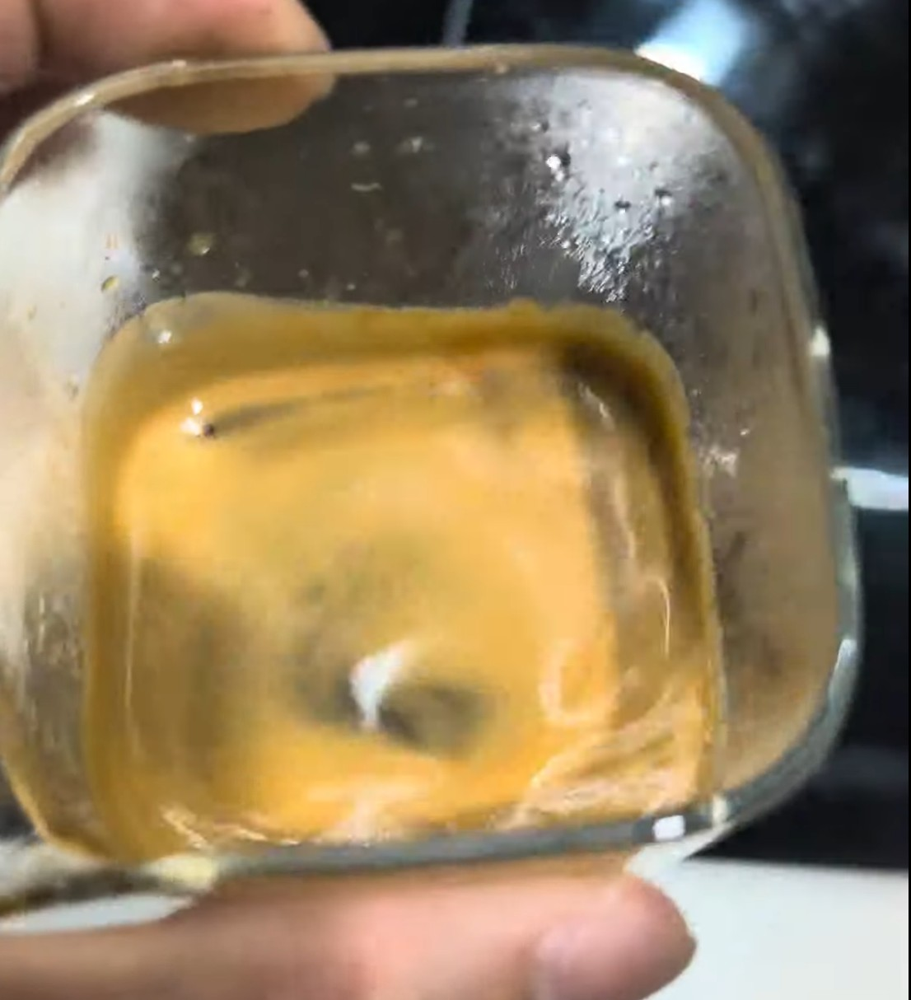

# ☕ Espresso: Oaxaca "Enmielado" (HiBrew H10 Plus + DF54)

## ☕ Ficha técnica
- **Método**: Espresso (HiBrew H10 Plus, portafiltro despresurizado 58mm)
- **Ratio**: 1:2
- **Café**: **18g** (Orgánico de Oaxaca "Enmielado" - Proceso Honey)
- **Rendimiento (Out)**: **36g** en taza
- **Molienda**: Espresso / **Nivel 13** en DF54
- **Temperatura**: **92°C** (PID)
- **Presión**: 8-9 bares (zona verde del manómetro)
- **Pre-infusión**: **6s**
- **Tiempo de extracción**: 25-28s

## 🛠️ Equipamiento adicional
- [x] Portafiltro despresurizado 58mm
- [x] Herramienta WDT y tamper manual
- [x] Báscula con cronómetro en la bandeja

## 📝 Procedimiento
1. **Precalentamiento**: Enciende la H10 Plus con el portafiltro enganchado para saturar el grupo térmico. Esperar **5:00**.
2. **Flash flush**: Haz un disparo corto de dos segundos sin café antes de cargar el portafiltro.
3. **Molienda y carga**: Muele 18g en **Nivel 13** de la DF54. Aplica WDT a fondo para romper grumos, nivela la superficie y compacta plano a 90° hasta el tope físico.
4. **Extracción**: Tara la báscula en cero con la taza colocada e inicia la extracción. La pre-infusión dura **6s**. La primera gota debe caer entre 0:07 y 0:09.
5. **Corte manual**: Cuando la báscula marque 34g, presiona el botón de la cafetera para detener la válvula y llegar a los 36g finales. La extracción debe terminar entre 0:25 y 0:28.

## 📸 Bitácora de Imágenes

## 💡 Notas y consejos
- *El Nivel 13 estabiliza la aguja en el centro de la zona verde (8-9 bares) para este perfil de origen. Es el punto dulce confirmado para proceso Honey.*
- *92°C realza las notas a durazno, cerezas y miel, con un cuerpo sedoso.*
